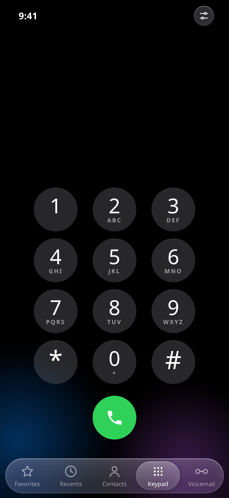
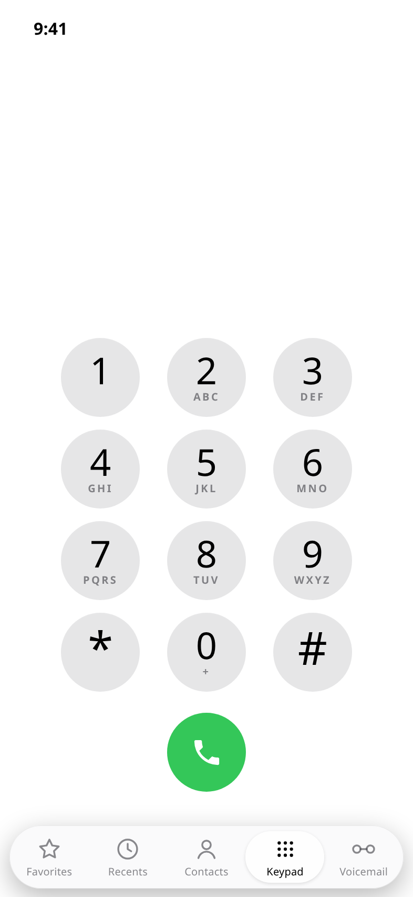
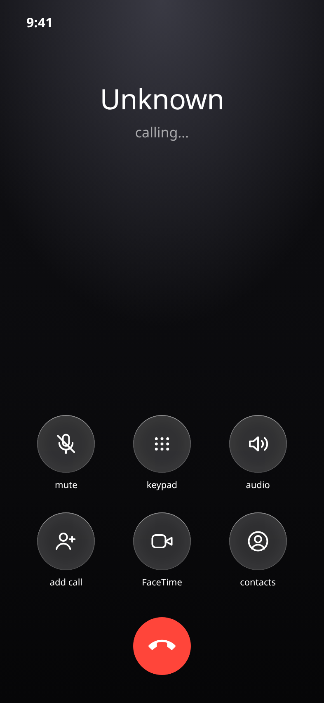
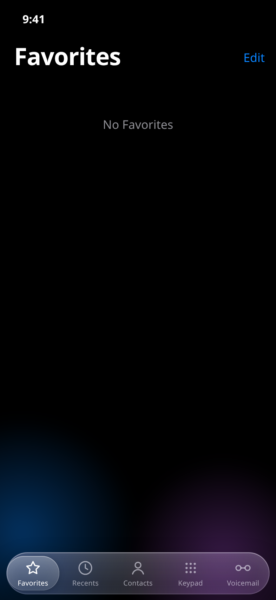
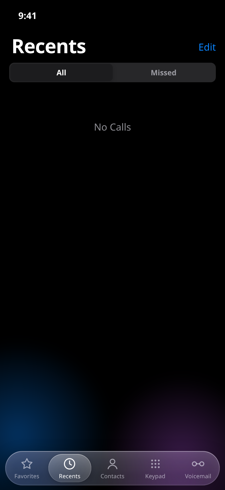

# Phone — iOS Dialer

A pixel-faithful reproduction of the iOS Phone app, shipped three ways from one codebase: an installable **Android APK**, an installable **web app (PWA)**, and a plain **HTML file**.

The Android build is a real dialer, not a mock: it reads your contacts and call log, places real calls, and — once it holds the default-dialer role — runs its own in-call screen with working speaker, mute, hold, DTMF keypad and recording.

<table>
  <tr>
    <td></td>
    <td></td>
    <td></td>
  </tr>
  <tr>
    <td align="center">Keypad · dark</td>
    <td align="center">Keypad · light</td>
    <td align="center">In-call</td>
  </tr>
  <tr>
    <td></td>
    <td></td>
    <td></td>
  </tr>
  <tr>
    <td align="center">Favorites</td>
    <td align="center">Recents</td>
    <td></td>
  </tr>
</table>

## Install

**Android (APK)** — grab it from the [latest release](https://github.com/technicalnihilist-lgtm/ios-phone-dialer/releases/latest) (or [`apk/Phone-Dialer.apk`](apk/Phone-Dialer.apk) in the repo), open it on the phone, and allow install from unknown sources when prompted. Android 7.0+ (API 24). Adaptive icon on Android 8+.

On first launch it asks for contacts, call log and phone permissions. The microphone is only requested when you tap **Record** during a call. To use the in-call controls, tap **Set** on the banner and make Phone your default dialer.

**iPhone / Android (web app)** — open <https://technicalnihilist-lgtm.github.io/ios-phone-dialer/> in Safari or Chrome, then *Share → Add to Home Screen*. It launches full screen with its own icon and works offline.

**Desktop** — just open `index.html`.

## What works

| Feature | Android app | Browser |
| --- | --- | --- |
| Real contacts from the device | yes (`READ_CONTACTS`) | empty state — no sample data |
| Real call history | yes (`READ_CALL_LOG`) | empty state — no sample data |
| Places real calls | yes (`CALL_PHONE`) | hands off to `tel:` |
| Speaker / mute / hold | yes, with the default-dialer role | simulated |
| DTMF keypad mid-call | yes | simulated |
| Call recording | attempted — see below | no |
| Offline | yes | yes (service worker) |

### About recording

Android 9 removed `VOICE_CALL` audio capture for ordinary apps, and Android 10+ blocks it outright. The record button tries `MediaRecorder` with the `VOICE_CALL` source; on devices that still permit it (some OEM builds) it writes an `.m4a` to the app's external files folder. Everywhere else the OS refuses and the app tells you so rather than pretending to record. No third-party dialer can bypass this — it needs root or a system signature.

### About the default-dialer role

Speaker, mute, hold and DTMF only work on a live call when the app owns the call, which means holding the dialer role (`InCallService`). Without the role the app still dials, but Android's own in-call screen takes over and these controls live there instead. The banner in the app requests the role.

## Keypad details

Real iOS metrics: 75pt keys, letters under each digit, T9 contact matching as you type (2-8-2 finds Ava), long-press `0` for `+`, long-press backspace to clear, long-press the empty area above the keypad for **Paste**. Five-tab Classic layout — Favorites, Recents, Contacts, Keypad, Voicemail — in a floating Liquid Glass tab bar whose selection capsule slides, stretches and can be dragged with a finger. Light and dark follow the system appearance, exactly as the real app does.

## Build the APK

Requires a JDK and Android build-tools. `android/build.sh` does everything: `aapt2` compile and link, `javac`, `d8`, zip, `zipalign`, then `apksigner` with an existing keystore. The script never mints a key: an APK signed with a fresh one would not install over the build already on the device. Point `KEYSTORE` at your key, or the build stops at an unsigned, aligned APK.

```bash
cd android
SDK=/path/to/android-sdk
KEYSTORE=/path/to/phone.keystore bash build.sh   # -> android/Phone-Dialer.apk
```

Unpack the three downloads the runbook names into `$SDK`: the Adoptium JDK (it unpacks to a
`jdk-17.0.x+y` directory, not `jdk`), `build-tools_r34-linux.zip` (unpacks to `android-14`) and
`platform-35_r01.zip` (unpacks to `android-35`, and provides `android.jar`). The script finds the
`jdk-*` directory itself and puts the JDK and build-tools on `PATH` for you — leave `JAVA_HOME`
unset, or point it at the directory that was actually unpacked. Setting it to a path that does not
exist makes the script stop with `no JDK found`, because it only searches when `JAVA_HOME` is empty.

Without `KEYSTORE` the script builds and aligns the APK and then stops, leaving an unsigned
`build/aligned.apk` and no `Phone-Dialer.apk`: never mint a key here, because an APK signed with a
fresh one will not install over the build already on the device.

## Project layout

```
index.html               the whole UI — one self-contained file
manifest.webmanifest     PWA manifest
sw.js                    service worker (offline cache)
icons/                   app icons (180 / 192 / 512)
screenshots/             rendered from index.html
apk/Phone-Dialer.apk     signed, installable build (v2.3 — see note below)
android/                 native app source
  AndroidManifest.xml    permissions, dialer role, InCallService
  src/com/phone/dialer/
    MainActivity.java    WebView shell + contacts/call-log/dial bridge
    DialerInCallService.java   owns the live call
    CallActivity.java    in-call screen: speaker, mute, hold, keypad, record
    DialerActivity.java  role-eligibility trampoline
  res/                   theme, styles, in-call layout and icons
  assets/index.html      the same UI, packaged
  build.sh               full toolchain build
```

## Notes

- The APK is signed with a locally generated key (`CN=Phone Dialer`), fine for sideloading but not a Play Store key.
- The bundled `apk/Phone-Dialer.apk` is the 2.3 build (versionCode 6): the source is at 2.6.17 (versionCode 44) but the signing
  key was not available for this release, and an APK signed with a fresh key would not install over the existing one.
- Typography is only pixel-identical on Apple hardware, where SF Pro resolves. Elsewhere it falls back to Helvetica Neue / the system sans.
- There is no sample data anywhere: contacts, call history and voicemail come from the device, so the browser build shows empty lists until the Android app fills them in.

## Store metadata

| Field | Value |
| --- | --- |
| App name | Phone |
| Package name / App ID | `com.phone.dialer` |
| Category | Utility |
| Version | 2.6.17 (versionCode 44) |
| Minimum Android | 7.0 (API 24) |
| Price | Free |
| Icon | https://raw.githubusercontent.com/technicalnihilist-lgtm/ios-phone-dialer/main/icons/icon-512.png |
| License | MIT |

---

## ⭐ Like this work? Give it a star

If you like this app and our work, please **star this repository** ⭐ and **[follow technicalnihilist-lgtm on GitHub](https://github.com/technicalnihilist-lgtm)**. If our work isn't for you, that's completely fine — the choice is yours. Thank you for stopping by!

<details>
<summary><b>🌍 Same message in 32 languages (A–Z + Indian languages)</b></summary>

- **A — Arabic** (العربية): ⭐ إذا أعجبك هذا التطبيق وعملنا، فيرجى منح المستودع نجمة ومتابعتنا. وإذا لم يعجبك عملنا، فلا مشكلة على الإطلاق — القرار قرارك. شكرًا لزيارتك!
- **B — Bengali** (বাংলা): ⭐ যদি আপনার এই অ্যাপ এবং আমাদের কাজ ভালো লাগে, তবে অনুগ্রহ করে রিপোজিটরিটিকে একটি স্টার দিন এবং আমাদের ফলো করুন। আমাদের কাজ যদি আপনার পছন্দ না হয়, তাতেও কোনো সমস্যা নেই — সিদ্ধান্ত আপনার। আমাদের পেজে আসার জন্য ধন্যবাদ!
- **C — Chinese** (中文): ⭐ 如果你喜欢这个应用和我们的作品，请给仓库点个星标并关注我们。如果我们的作品不适合你，也完全没关系——选择权在你。感谢你的到访！
- **D — Dutch** (Nederlands): ⭐ Vind je deze app en ons werk leuk? Geef de repository dan een ster en volg ons. Vind je ons werk niets, dan is dat helemaal prima — de keuze is aan jou. Bedankt voor je bezoek!
- **E — English** (English): ⭐ If you like this app and our work, please give the repository a star and follow us. If our work isn't for you, that's completely fine — the choice is yours. Thank you for stopping by!
- **F — French** (Français): ⭐ Si cette application et notre travail vous plaisent, mettez une étoile au dépôt et suivez-nous. Si notre travail n'est pas pour vous, aucun souci — c'est votre choix. Merci de votre visite !
- **G — German** (Deutsch): ⭐ Wenn dir diese App und unsere Arbeit gefallen, gib dem Repository einen Stern und folge uns. Wenn unsere Arbeit nichts für dich ist, ist das völlig in Ordnung — die Wahl liegt bei dir. Danke fürs Vorbeischauen!
- **H — Hindi** (हिन्दी): ⭐ अगर आपको यह ऐप और हमारा काम पसंद है, तो कृपया रिपॉजिटरी को स्टार दें और हमें फॉलो करें। अगर हमारा काम आपके लिए नहीं है, तो भी कोई बात नहीं — यह पूरी तरह आपकी मर्ज़ी है। यहाँ आने के लिए आपका धन्यवाद!
- **I — Indonesian** (Bahasa Indonesia): ⭐ Jika kamu suka aplikasi ini dan karya kami, beri bintang pada repositori ini dan ikuti kami. Kalau karya kami bukan untukmu, tidak masalah sama sekali — itu pilihanmu. Terima kasih sudah mampir!
- **J — Japanese** (日本語): ⭐ このアプリと私たちの仕事が気に入ったら、リポジトリにスターを付けてフォローしてください。合わない場合はまったく問題ありません — 選ぶのはあなたです。お越しいただきありがとうございます！
- **K — Korean** (한국어): ⭐ 이 앱과 저희 작업이 마음에 드신다면 저장소에 스타를 눌러 주시고 팔로우해 주세요. 저희 작업이 맞지 않으셔도 전혀 괜찮습니다 — 선택은 여러분의 몫입니다. 방문해 주셔서 감사합니다!
- **L — Lithuanian** (Lietuvių): ⭐ Jei tau patinka ši programa ir mūsų darbas, duok saugyklai žvaigždutę ir sek mus. Jei mūsų darbas ne tau, viskas gerai — pasirinkimas tavo. Ačiū, kad užsukai!
- **M — Malayalam** (മലയാളം): ⭐ നിങ്ങൾക്ക് ഈ ആപ്പും ഞങ്ങളുടെ പ്രവർത്തനവും ഇഷ്ടപ്പെട്ടെങ്കിൽ, ദയവായി റെപ്പോസിറ്ററിക്ക് ഒരു സ്റ്റാർ നൽകുകയും ഞങ്ങളെ ഫോളോ ചെയ്യുകയും ചെയ്യുക. ഞങ്ങളുടെ പ്രവർത്തനം നിങ്ങൾക്ക് അനുയോജ്യമല്ലെങ്കിൽ, അതും തികച്ചും കുഴപ്പമില്ല — തീരുമാനം നിങ്ങളുടേതാണ്. ഇവിടെ വന്നതിന് നന്ദി!
- **N — Nepali** (नेपाली): ⭐ यदि तपाईंलाई यो एप र हाम्रो काम मन पर्‍यो भने, कृपया रिपोजिटरीलाई स्टार दिनुहोस् र हामीलाई फलो गर्नुहोस्। यदि हाम्रो काम तपाईंलाई मन पर्दैन भने, पनि ठीकै छ — यो तपाईंको इच्छा हो। यहाँ आउनुभएकोमा धन्यवाद!
- **O — Odia** (ଓଡ଼ିଆ): ⭐ ଯଦି ଆପଣଙ୍କୁ ଏହି ଆପ୍ ଏବଂ ଆମର କାମ ଭଲ ଲାଗୁଛି, ତେବେ ଦୟାକରି ରିପୋଜିଟୋରୀକୁ ଗୋଟିଏ ଷ୍ଟାର୍ ଦିଅନ୍ତୁ ଏବଂ ଆମକୁ ଫଲୋ କରନ୍ତୁ। ଯଦି ଆମର କାମ ଆପଣଙ୍କ ପାଇଁ ନୁହେଁ, ତେବେ କିଛି ଅସୁବିଧା ନାହିଁ — ପସନ୍ଦ ଆପଣଙ୍କର। ଆମ ପାଖକୁ ଆସିଥିବାରୁ ଧନ୍ୟବାଦ!
- **P — Polish** (Polski): ⭐ Jeśli podoba Ci się ta aplikacja i nasza praca, daj repozytorium gwiazdkę i obserwuj nas. Jeśli nasza praca nie jest dla Ciebie, to zupełnie w porządku — wybór należy do Ciebie. Dziękujemy za odwiedziny!
- **Q — Quechua** (Runa Simi): ⭐ Kay app, ñuqaykup ruwasqanchikpas gustasunki chayqa, repositorioman huk estrella churay, ñuqaykutapas qatipayku. Mana gustasunki chayqa, allinmi — qampa akllayki. Hamusqaykimanta sulpayki!
- **R — Russian** (Русский): ⭐ Если вам нравится это приложение и наша работа, поставьте звёздочку репозиторию и подпишитесь на нас. Если наша работа не для вас — это совершенно нормально, выбор за вами. Спасибо, что заглянули!
- **S — Spanish** (Español): ⭐ Si te gusta esta app y nuestro trabajo, dale una estrella al repositorio y síguenos. Si nuestro trabajo no es para ti, no pasa nada — la decisión es tuya. ¡Gracias por pasarte!
- **T — Tamil** (தமிழ்): ⭐ உங்களுக்கு இந்த ஆப்பும் எங்க வேலையும் பிடிச்சிருந்தா, தயவுசெஞ்சு இந்த ரெபாசிட்டரிக்கு ஒரு ஸ்டார் குடுத்து, எங்களை ஃபாலோ பண்ணுங்க. எங்க வேலை உங்களுக்கு செட் ஆகலைன்னாலும் பரவாயில்லை — அது உங்க விருப்பம். இங்கே வந்ததுக்கு நன்றி!
- **U — Urdu** (اردو): ⭐ اگر آپ کو یہ ایپ اور ہمارا کام پسند آئے تو براہ کرم ریپازٹری کو سٹار دیں اور ہمیں فالو کریں۔ اگر ہمارا کام آپ کے لیے نہیں ہے، تو یہ بالکل ٹھیک ہے — انتخاب آپ کا ہے۔ یہاں تشریف لانے کا شکریہ!
- **V — Vietnamese** (Tiếng Việt): ⭐ Nếu bạn thích ứng dụng này và công việc của chúng tôi, hãy tặng kho lưu trữ một ngôi sao và theo dõi chúng tôi. Nếu công việc của chúng tôi không phù hợp với bạn, điều đó hoàn toàn ổn — lựa chọn là của bạn. Cảm ơn bạn đã ghé qua!
- **W — Welsh** (Cymraeg): ⭐ Os ydych chi'n hoffi'r ap hwn a'n gwaith, rhowch seren i'r storfa a dilynwch ni. Os nad yw ein gwaith ar eich cyfer, mae hynny'n hollol iawn — chi sydd i benderfynu. Diolch am alw heibio!
- **X — Xhosa** (isiXhosa): ⭐ Ukuba uyayithanda le app nomsebenzi wethu, nika irepo inkwenkwezi kwaye usilandele. Ukuba umsebenzi wethu awukufanelanga, akukho ngxaki — lukhetho lwakho. Enkosi ngokutyelela!
- **Y — Yoruba** (Yorùbá): ⭐ Bí app yìí àti iṣẹ́ wa bá wù ọ́, jọ̀wọ́ fún àkójọpọ̀ náà ní ìràwọ̀ kí o sì tẹ̀lé wa. Bí iṣẹ́ wa kò bá yẹ ọ́, kò séwu — ìwọ ni ó yàn. Ẹ ṣé fún wíwá!
- **Z — Zulu** (isiZulu): ⭐ Uma uthanda le app nomsebenzi wethu, nikeza isitoreji inkanyezi bese usilandela. Uma umsebenzi wethu ungakufanele, akunankinga — wukukhetha kwakho. Siyabonga ngokuvakasha!

**More Indian languages**

- **Assamese** (অসমীয়া): ⭐ যদি আপুনি এই এপটো আৰু আমাৰ কাম ভাল পায়, তেন্তে অনুগ্ৰহ কৰি ৰিপজিটৰীটোক এটা ষ্টাৰ দিয়ক আৰু আমাক ফ'ল' কৰক। যদি আমাৰ কাম আপোনাৰ বাবে নহয়, তেন্তে সেয়া একেবাৰে ঠিক আছে — সিদ্ধান্তটো আপোনাৰ। আমাৰ ইয়ালৈ অহাৰ বাবে ধন্যবাদ!
- **Gujarati** (ગુજરાતી): ⭐ જો તમને આ એપ અને અમારું કામ ગમતું હોય, તો પ્લીઝ રિપોઝિટરીને સ્ટાર આપો અને અમને ફોલો કરો. જો અમારું કામ તમને ન ગમતું હોય, તો તે પણ બરાબર છે — પસંદગી તમારી છે. અહીં આવવા બદલ આભાર!
- **Kannada** (ಕನ್ನಡ): ⭐ ನಿಮಗೆ ಈ ಆ್ಯಪ್ ಮತ್ತು ನಮ್ಮ ಕೆಲಸ ಇಷ್ಟವಾದರೆ, ದಯವಿಟ್ಟು ರೆಪೊಸಿಟರಿಗೆ ಸ್ಟಾರ್ ಕೊಡಿ ಮತ್ತು ನಮ್ಮನ್ನು ಫಾಲೋ ಮಾಡಿ. ನಮ್ಮ ಕೆಲಸ ನಿಮಗೆ ಸರಿಹೊಂದದಿದ್ದರೆ, ಅದೂ ಪರವಾಗಿಲ್ಲ — ಆಯ್ಕೆ ನಿಮ್ಮದು. ಭೇಟಿ ನೀಡಿದ್ದಕ್ಕೆ ಧನ್ಯವಾದಗಳು!
- **Marathi** (मराठी): ⭐ जर तुम्हाला हे ॲप आणि आमचं काम आवडलं असेल, तर कृपया रिपॉझिटरीला स्टार द्या आणि आम्हाला फॉलो करा. जर आमचं काम तुम्हाला आवडत नसेल, तर काही हरकत नाही — ती तुमची निवड आहे. इथे आल्याबद्दल धन्यवाद!
- **Punjabi** (ਪੰਜਾਬੀ): ⭐ ਜੇ ਤੁਹਾਨੂੰ ਇਹ ਐਪ ਅਤੇ ਸਾਡਾ ਕੰਮ ਪਸੰਦ ਹੈ, ਤਾਂ ਕਿਰਪਾ ਕਰਕੇ ਰਿਪੋਜ਼ਟਰੀ ਨੂੰ ਸਟਾਰ ਦਿਓ ਅਤੇ ਸਾਨੂੰ ਫਾਲੋ ਕਰੋ। ਜੇ ਸਾਡਾ ਕੰਮ ਤੁਹਾਡੇ ਲਈ ਨਹੀਂ ਹੈ, ਤਾਂ ਕੋਈ ਗੱਲ ਨਹੀਂ — ਚੋਣ ਤੁਹਾਡੀ ਹੈ। ਸਾਡੇ ਪੇਜ 'ਤੇ ਆਉਣ ਲਈ ਧੰਨਵਾਦ!
- **Telugu** (తెలుగు): ⭐ మీకు ఈ యాప్, మా పని నచ్చితే, దయచేసి రిపోజిటరీకి ఒక స్టార్ ఇచ్చి మమ్మల్ని ఫాలో అవ్వండి. ఒకవేళ మా పని మీకు నచ్చకపోతే, పర్వాలేదు — అది మీ ఇష్టం. మమ్మల్ని సందర్శించినందుకు ధన్యవాదాలు!

</details>
