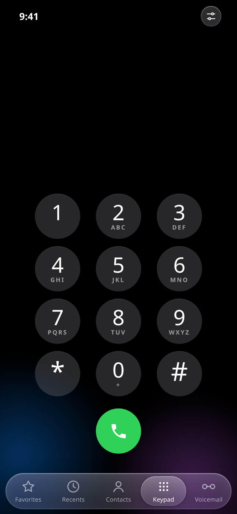
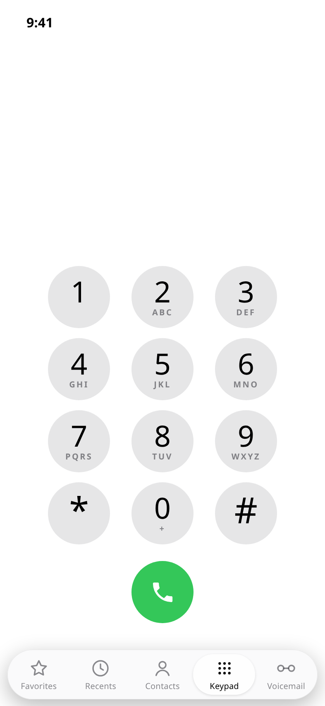
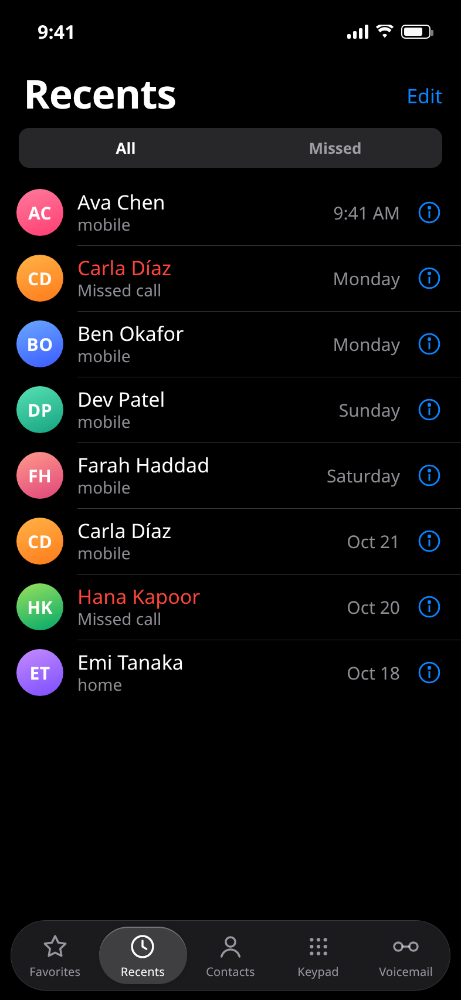
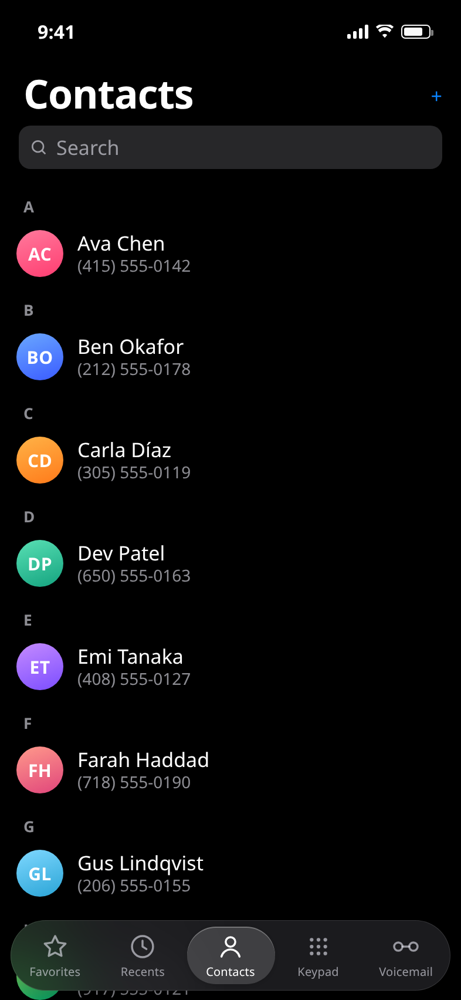
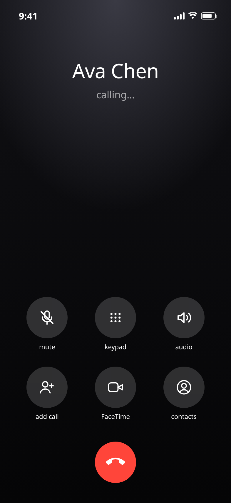

# Phone — iOS Dialer

A pixel-faithful reproduction of the iOS Phone app, shipped three ways from one codebase: an installable **Android APK**, an installable **web app (PWA)**, and a plain **HTML file**.

<table>
  <tr>
    <td></td>
    <td></td>
    <td></td>
  </tr>
  <tr>
    <td align="center">Keypad · dark</td>
    <td align="center">Keypad · light</td>
    <td align="center">Recents</td>
  </tr>
  <tr>
    <td></td>
    <td></td>
    <td></td>
  </tr>
  <tr>
    <td align="center">Contacts</td>
    <td align="center">In-call screen</td>
    <td></td>
  </tr>
</table>

## Install

**Android (APK)** — download [`apk/Phone-Dialer.apk`](apk/Phone-Dialer.apk), open it on the phone, and allow install from unknown sources when prompted. Android 7.0+ (API 24).

**iPhone / Android (web app)** — open <https://technicalnihilist-lgtm.github.io/ios-phone-dialer/> in Safari or Chrome, then *Share → Add to Home Screen*. It launches full screen with its own icon and works offline.

**Desktop** — just open `index.html`.

## What it does

- **Keypad** with the real iOS metrics: 75pt keys, letters under each digit, T9 contact matching as you type (2-8-2 finds Ava), long-press `0` for `+`, long-press backspace to clear, long-press the empty area above the keypad for **Paste**.
- **Five-tab Classic layout** — Favorites, Recents, Contacts, Keypad, Voicemail — in a floating Liquid Glass tab bar whose selection capsule slides, stretches and can be dragged with a finger.
- **Real dialing.** The green button hands the number to the system dialer (`tel:`). On desktop, where there is no dialer, it shows the in-call screen instead.
- **Call history** is saved to `localStorage` and appears at the top of Recents.
- **Light and dark** follow the system appearance, exactly as the real app does — there is no in-app theme switch, because there isn't one on iOS.

## Build the APK

Requires a JDK and Android build-tools. `android/build.sh` does everything: `aapt2` compile and link, `javac`, `d8`, zip, `zipalign`, then `apksigner` with a generated keystore.

```bash
cd android
# point these at your own SDK
SDK=/path/to/android-sdk
export JAVA_HOME=$SDK/jdk
export PATH=$JAVA_HOME/bin:$SDK/build-tools/34.0.0:$PATH
bash build.sh          # -> android/Phone-Dialer.apk
```

The script expects `$SDK/android-35/android.jar` and `$SDK/android-14` (build-tools 34); adjust the two variables at the top for your layout.

## Project layout

```
index.html               the whole app — one self-contained file
manifest.webmanifest     PWA manifest
sw.js                    service worker (offline cache)
icons/                   app icons (180 / 192 / 512)
screenshots/             rendered from index.html
apk/Phone-Dialer.apk     signed, installable build
android/                 native wrapper source
  AndroidManifest.xml
  src/com/phone/dialer/MainActivity.java
  res/                   theme, strings, launcher icons
  assets/index.html      the same app, packaged
  build.sh               full toolchain build
```

The Android app is a thin native shell: a `WebView` that loads `index.html` from assets, goes edge-to-edge, and intercepts `tel:` links so they leave the app for the system dialer.

## Notes

- The APK is signed with a locally generated key (`CN=Phone Dialer`), which is fine for sideloading but is not a Play Store key. Keep your own keystore if you plan to publish updates.
- Typography is only pixel-identical on Apple hardware, where SF Pro resolves. Elsewhere it falls back to Helvetica Neue / the system sans.
- Contact names, numbers and call history are sample data.
